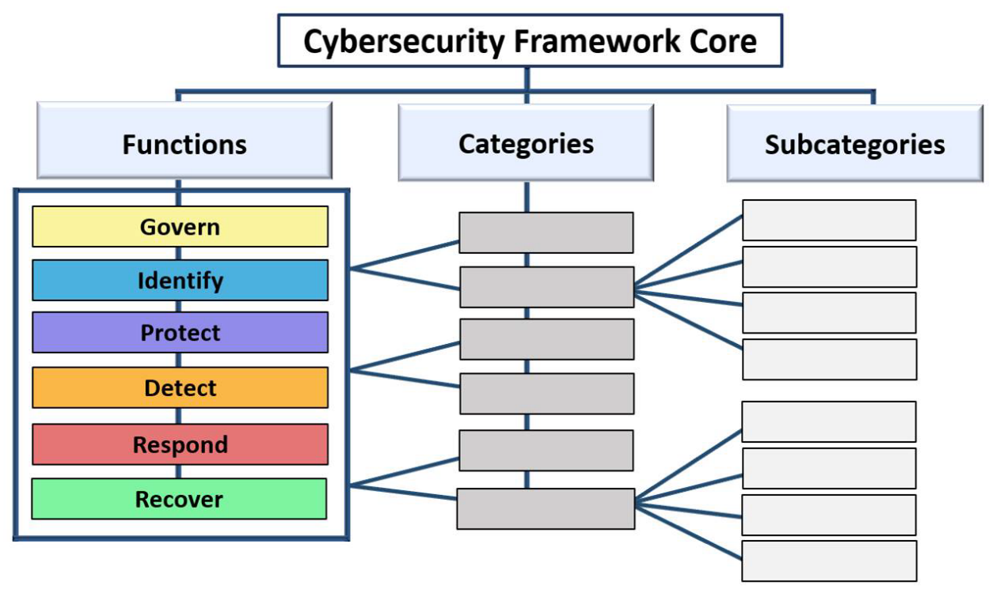
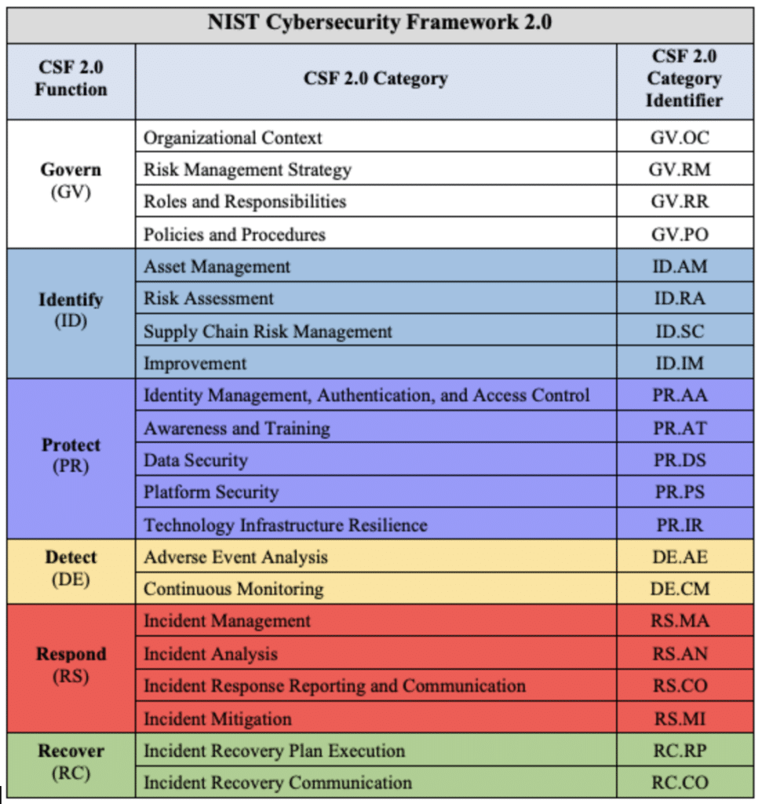
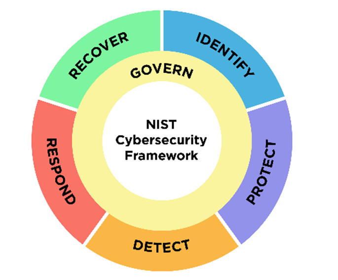
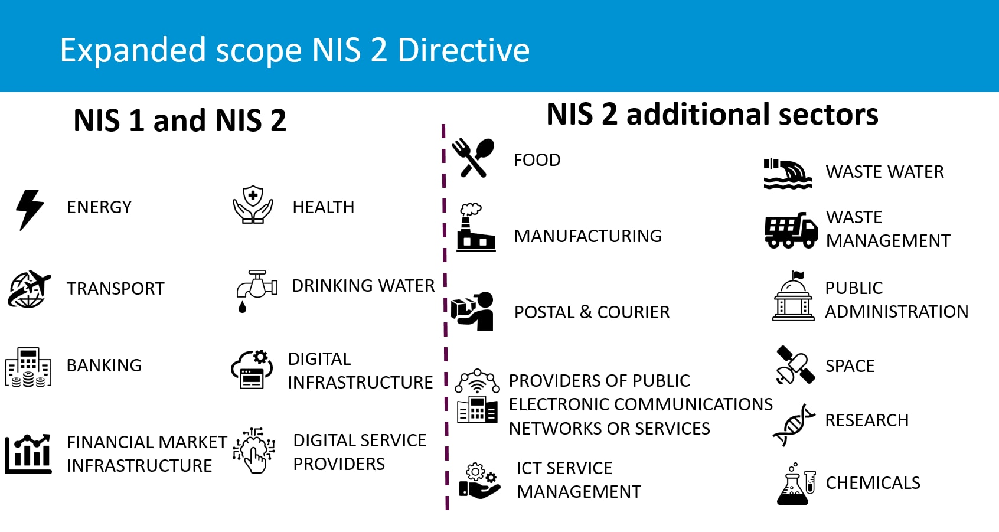
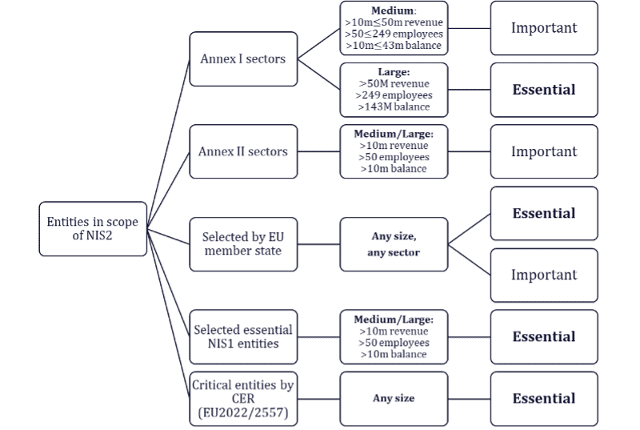
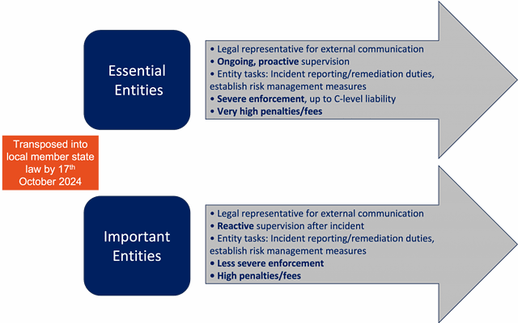
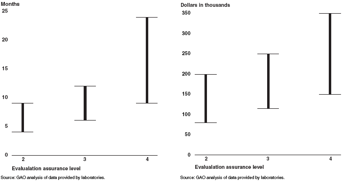
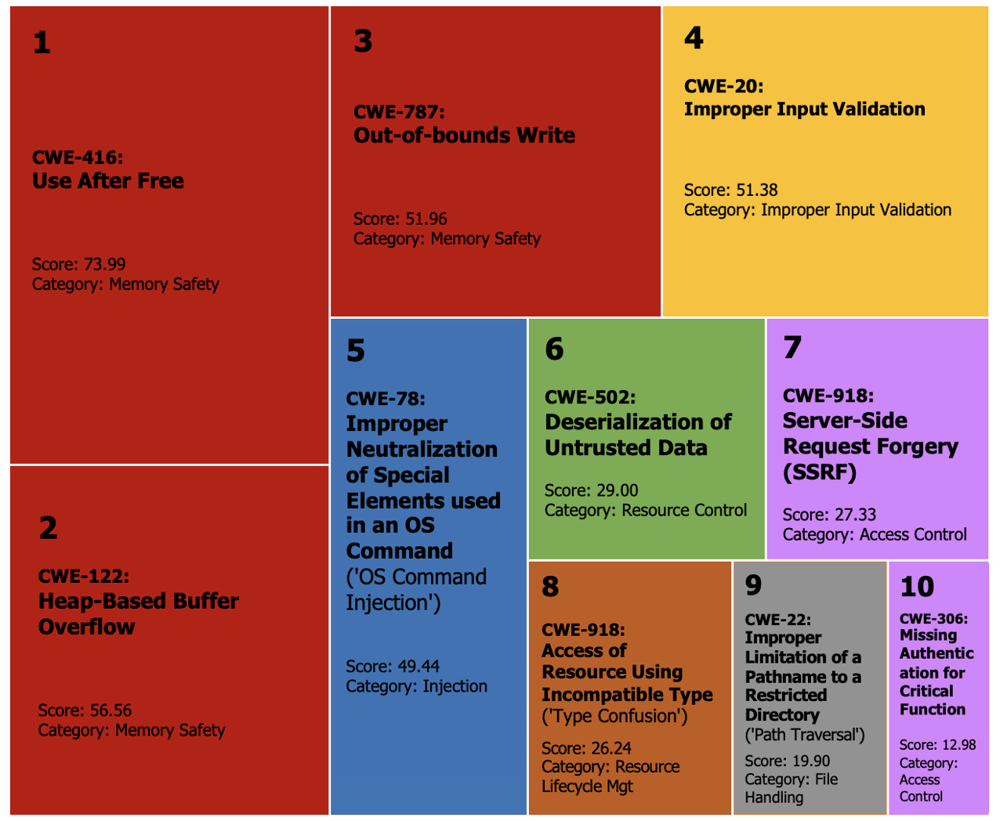

---
layout: section
class: text-center
---
# - Grading
---
layout: section
class: text-center
---
# - Lecture topics
---
layout: section
class: text-center
---
# - Resources
---
layout: section
class: text-center
---
# - Resources
---
layout: section
class: text-center
---
# - Introduction to cyber defenses
---

# - NIST’s cybersecurity framework (CSF)

---

# - NIST’s cybersecurity framework slides

---
layout: section
class: text-center
---
# - NIST’s cybersecurity framework
---
layout: two-cols
---

# - Network and Information Security Directive 2

https://cybeready.com/wp-content/uploads/nis_directive_cxxgrk.png

::right::

---
layout: two-cols
---

# - Network and Information Security Directive 2

https://verveindustrial.com/resources/whitepaper/nis2-cybersecurity-directive-for-eu/

::right::

---
layout: two-cols
---

# - Network and Information Security Directive 2

https://verveindustrial.com/resources/whitepaper/nis2-cybersecurity-directive-for-eu/

::right::

---

# - Network and Information Security Directive 2

https://verveindustrial.com/resources/whitepaper/nis2-cybersecurity-directive-for-eu/

---
layout: section
class: text-center
---
# - Common criteria
---
layout: section
class: text-center
---
# - Common criteria
---
layout: two-cols
---

# - Common criteria

https://en.wikipedia.org/wiki/Evaluation_Assurance_Level

::right::

---
layout: section
class: text-center
---
# - Common criteria
---
layout: section
class: text-center
---
# - Common criteria
---
layout: section
class: text-center
---
# - MITRE ATT&CK
---
layout: section
class: text-center
---
# - MISP
---
layout: section
class: text-center
---
# - Lockheed Martin Cyber Kill Chain
---

# - CWE

---
layout: section
class: text-center
---
# - Introduction to cyber threats
---
layout: section
class: text-center
---
# - Types of attackers
---
layout: section
class: text-center
---
# - Types of attacks
---
layout: section
class: text-center
---
# - References