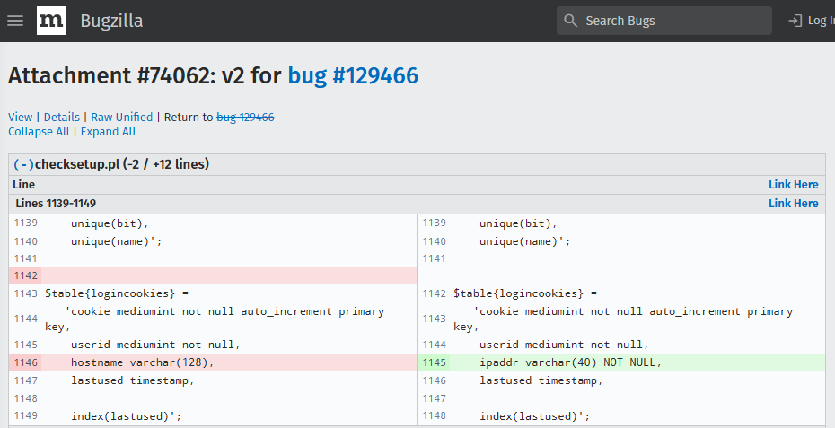
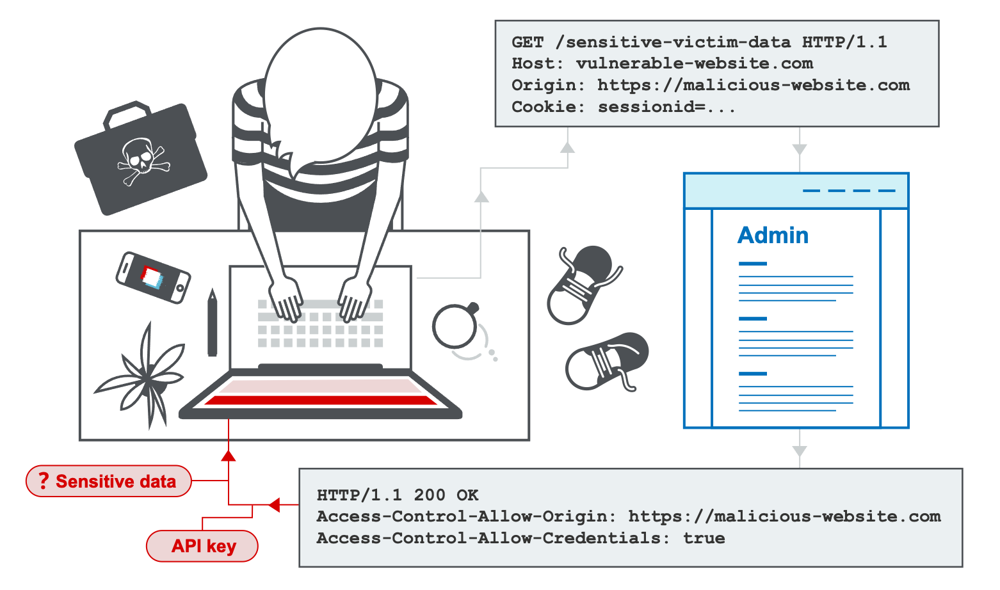

---
layout: section
class: text-center
---
# - Learn more from
---
layout: section
class: text-center
---
# - A01:2025 - Broken Access Control
- A02:2025 - Security Misconfiguration
- A03:2025 - Software Supply Chain Failures
- A04:2025 - Cryptographic Failures
- A05:2025 - Injection
- A06:2025 - Insecure Design
- A07:2025 - Authentication Failures
- A08:2025 - Software or Data Integrity Failures
- A09:2025 - Logging & Alerting Failures
- A10:2025 - Mishandling of Exceptional Conditions
---

# - CWE-918 Server-Side Request Forgery (SSRF)
  - Server accesses attacker-given (internal) location

- curl https://localhost/fetch_data?url=http://10.0.0.1/latest_secret

`@app.route('/fetch_data')`
`def ``fetch_data``():`
`    ``data_url`` = ``request.args.get``('``url``')`
`    try:`
`        # VULNERABILITY: The server makes the request to an untrusted URL without validation`
`        response = ``requests.get``(``data_url``)`
`        return Response(``response.content``)`
`    except Exception as e:`
`        return ``f"Error`` fetching data: {e}", 500`

<!--
Demo: go to https://cwe.mitre.org/data/definitions/918.html; select from bottom CVE-2021-21972 (vSphere Client) -> search the CVE on the exploitdb (https://www.exploit-db.com/exploits/50056)
-->
---

# - CWE-352: Cross-Site Request Forgery (CSRF)
  - Authenticated user executes attackers-choice action

`<html>`
`  <body>`
`    <h1>You Won!</h1>`
`    <form action="http://vulnerable-bank.com/transfer" method="POST" id="``csrfForm``">`
`      <input type="hidden" name="``to_account``" value="ATTACKER_ACCOUNT" />`
`      <input type="hidden" name="amount" value="5000" />`
`    </form>`
`    `
`  </body>`
`</html>`

<!--
Go to https://www.cve.org/CVERecord/SearchResults?query=csrf and serach for the keyword csrf
-->
---
layout: focus
---
# - CWE-611 Improper Restriction of XML External Entity Reference (XXE).
  - The XML parser weakly handles attacker’s input (and explodes)

- <!DOCTYPE foo [ <!ENTITY xxe SYSTEM "file:///etc/passwd"> ]>
- <foo>&xxe;</foo>

`app.post``('/``process_xml``', (req, res) => {`
`    try {`
`        // VULNERABILITY: '``noent``: true' enables entity substitution, '``dtdload``: true' loads external DTDs.`
`        // This configuration allows XXE.`
`        const ``xmlDoc`` = ``libxmljs.parseXml``(``req.body``, { ``noent``: true, ``dtdload``: true });`
`        ``res.send``(``xmlDoc.root``().text());`
`    } catch (e) {`
`        ``res.status``(500).send(``e.message``);`
`    }`
`});`
---

# - CWE-260 Password in Configuration File

- wget https://localhost/config.py :)

`class ``ProductionConfig``:`
`    # VULNERABILITY: Hardcoded credentials in source code`
`    DB_HOST = '``prod.database.internal``'`
`    DB_USER = '``admin_user``'`
`    DB_PASS = 'SuperSecretProductionPassword123!'`

---
layout: focus
---
# - CWE-477: Use of Obsolete Function
- CWE-1104: Use of Unmaintained Third Party Components

- OpenSSL (CVE-2014-0160)
- Log4Shell (CVE-2021-44228)
- XZ (CVE-2024-3094)

`{`
`  "name": "my-application",`
`  "version": "1.0.0",`
`  "dependencies": {`
`    "express": "4.17.1",`
`    "``lodash``": "4.17.15" `
`    // VULNERABILITY: This version of ``lodash`` is vulnerable to Prototype Pollution (CVE-2019-10744)`
`  }`
`}`
---

# - CWE-327 Use of a Broken or Risky Cryptographic Algorithm

- https://www.mathstat.dal.ca/~selinger/md5collision/
- https://www.cve.org/CVERecord?id=CVE-2025-55796

`import ``hashlib`

`def ``hash_password_insecure``(password):`
`    # VULNERABILITY: Using MD5 for password hashing. It is too fast and vulnerable to collisions.`
`    return hashlib.md5(``password.encode``('utf-8')).``hexdigest``()`

`# Modern applications must use ``bcrypt``, ``scrypt``, or Argon2.`

---

# - CWE-1241: Use of Predictable Algorithm in Random Number Generator

- The Mersenne Twister
  - https://agrohacksstuff.io/posts/pseudo-random-number-generators-and-why-you-should-tread-lightly/

`function ``generateSessionToken``() {`
`    // VULNERABILITY: ``Math.random``() is not cryptographically secure and can be predicted.`
`    return ``Math.random``().``toString``(36).substring(2);`
`}`

`// Correct approach (Browser): ``window.crypto.getRandomValues``()`
`// Correct approach (Node.js): ``crypto.randomBytes``()`

---

# - CWE-89 Improper Neutralization of Special Elements used in an SQL Command ('SQL Injection’)

- 1 UNION SELECT password, NULL FROM secrets

`@app.route('/users')`
`def ``get_user``():`
`    ``user_id`` = ``request.args.get``('id')`
`    `
`    conn = sqlite3.connect('``app.db``')`
`    cursor = ``conn.cursor``()`
`    `
`    # VULNERABILITY: Direct string interpolation of user input`
`    query = ``f"SELECT`` username, email FROM users WHERE id = {``user_id``}"`
`    `
`    ``cursor.execute``(query)`

---
layout: section
class: text-center
---
# - SQL Injection in practice
---
layout: focus
---
# - CWE-78 Improper Neutralization of Special Elements used in an OS Command ('OS Command Injection’)

- https://localhost/ping?host=google.com; cat /etc/passwd

`app.get``('/ping', (req, res) => {`
`    const host = ``req.query.host``;`
`    `
`    // VULNERABILITY: Executing a command constructed with user input`
`    const command = `ping -c 1 ${host}`;`
`    `
`    exec(command, (error, ``stdout``, stderr) => {`
`        ``res.send``(`<pre>${``stdout``}</pre>`);`
`    });`
`});`
---

# - CWE-434 Unrestricted Upload of File with Dangerous Type
  - .php, .js, .py

`# Assuming this folder is served by the web server`
`UPLOAD_FOLDER = './``webroot``/uploads' `

`@app.route('/upload_image', methods=['POST'])`
`def ``upload_image``():`
`    file = ``request.files``['file']`
`    `
`    # VULNERABILITY: No validation of file type (MIME type) or content.`
`    # An attacker can upload '``webshell.php``' or '``exploit.jsp``'.`
`    ``filepath`` = ``os.path.join``(UPLOAD_FOLDER, ``file.filename``)`
`    ``file.save``(``filepath``)`
`    `
`    return ``f"File`` uploaded successfully to /uploads/{``file.filename``}", 200`

---

# - CWE-602 Client-Side Enforcement of Server-Side Security
  - No server-side validation

`<form action="/purchase" method="POST">`
`    <input type="hidden" name="``itemId``" value="101">`
`    <input type="text" name="price" value="500.00" ``readonly``>`
`    <input type="submit" value="Buy Now">`
`</form>`

---

# - CWE-384 Session Fixation
  - The attacker can dictate the session ID (his own) (e.g. because no session invalidation is done on server side)
  - https://localhost/?SID=ATTACKER_KNOWN_ID

- https://www.cve.org/CVERecord?id=CVE-2022-2820
  - Gamers could plays other’s game if session was guessed

`<form method="POST" action="``j_security_check``">`
`	<input type="text" name="``j_username``">`
`	<input type="text" name="``j_password``">`
`</form>`

`# bad code as no session is created`

---

# - CWE-350: Reliance on Reverse DNS Resolution for a Security-Critical Action

<!--
Idea aici era ca puteai sa te autentifici de la distanta cu orice ip daca faceai autentificarea pe baza de nume iar la reverse_dns acel nume dadea ip-ul atacatorului
-->
---

# - CWE-502 Deserialization of Untrusted Data
  - Eg. Python's pickle module allows execution of arbitrary code during deserialization

- CVE-2024-37288
  - A deserialization issue in Kibana can lead to arbitrary code execution when Kibana attempts to parse a YAML document containing a crafted payload.

`# --- Vulnerable application code ---`
`@app.route('/load_profile', methods=['POST'])`
`def ``load_profile``():`
`    profile_data_b64 = ``request.data`
`    data = base64.b64decode(profile_data_b64)`
`    # VULNERABILITY: Deserializing untrusted data`
`    profile = ``pickle.loads``(data)`
`    return "Profile loaded"`

`# --- Attacker generates payload ---`
`# class RCE:`
`#     def __reduce__(self):`
`#         # This command will be executed when the object is unpickled on the server`
`#         ``cmd`` = ('touch /``tmp``/hacked.txt',) `
`#         return ``os.system``, ``cmd`
`# ``exploit_payload`` = base64.b64encode(``pickle.dumps``(RCE())).decode()`

---
layout: section
class: text-center
---
# - CWE-353 Missing Support for Integrity Check
  - No MAC on cookie
---

# - CWE-532 Insertion of Sensitive Information into Log File

`@app.route('/login', methods=['POST'])`
`def login():`
`    username = ``request.form.get``('username')`
`    password = ``request.form.get``('password')`
`    # VULNERABILITY: Logging the plaintext password`
`    app.logger.info(``f"Login`` attempt for user: {username}, password: {password}")`
`    # ... authentication logic ...`
`    return "Attempt processed"`

---
layout: section
class: text-center
---
# - CWE-209 Generation of Error Message Containing Sensitive Information
  - Debug ON
---

# - CWE-636 Not Failing Securely ('Failing Open’)

- CVE-2024-2660

`def ``verify_user_license``():`
`    try:`
`        # Simulate checking an external licensing service`
`        response = ``requests.get``("http://license-service/verify", timeout=1)`
`        return ``response.json``().get('``isValid``', False)`
`    except ``requests.exceptions.RequestException``:`
`        # VULNERABILITY: Failing open if the service is down or times out`
`        ``app.logger.error``("License service unavailable. Proceeding.")`
`        return True # Fails Open (Should be False for Fail Closed)`

`@app.route('/premium_feature')`
`def ``premium_feature``():`
`    if not ``verify_user_license``():`
`        abort(403)`
`    return "Access Granted to Premium Feature"`

---
layout: section
class: text-center
---
# - Browser security
---
layout: two-cols
---

# - Browser security

https://portswigger.net/web-security/cors#what-is-cors-cross-origin-resource-sharing

::right::

---

# - Browser security

https://developer.mozilla.org/en-US/docs/Web/HTTP/Reference/Headers

---

# - Browser security

https://developer.mozilla.org/en-US/docs/Web/HTTP/Reference/Headers

---

# - Browser security

- https://developer.mozilla.org/en-US/docs/Web/HTTP/Reference/Headers

---

# - Browser security

- https://developer.mozilla.org/en-US/docs/Web/HTTP/Reference/Headers

---

# - Browser security

- https://developer.mozilla.org/en-US/docs/Web/HTTP/Reference/Headers

---
layout: section
class: text-center
---
# - Browser security
---
layout: section
class: text-center
---
# - Web Application Filtering