---
layout: section
class: text-center
---
# What is network security
---
layout: section
class: text-center
---
# Only “trusted” traffic
---
layout: section
class: text-center
---
# Types of firewalls
---
layout: section
class: text-center
---
# Network based application recognition
---
layout: section
class: text-center
---
# CIA for protocols
---
layout: section
class: text-center
---
# CIA for protocols
---
layout: section
class: text-center
---
# CIA for protocols
---
layout: section
class: text-center
---
# CIA for DNS (intro Domain Name Server - 1983)
---
layout: two-cols
---

# CIA for DNS (msg format)

**https://www.geeksforgeeks.org/dns-message-format/**** **

::right::

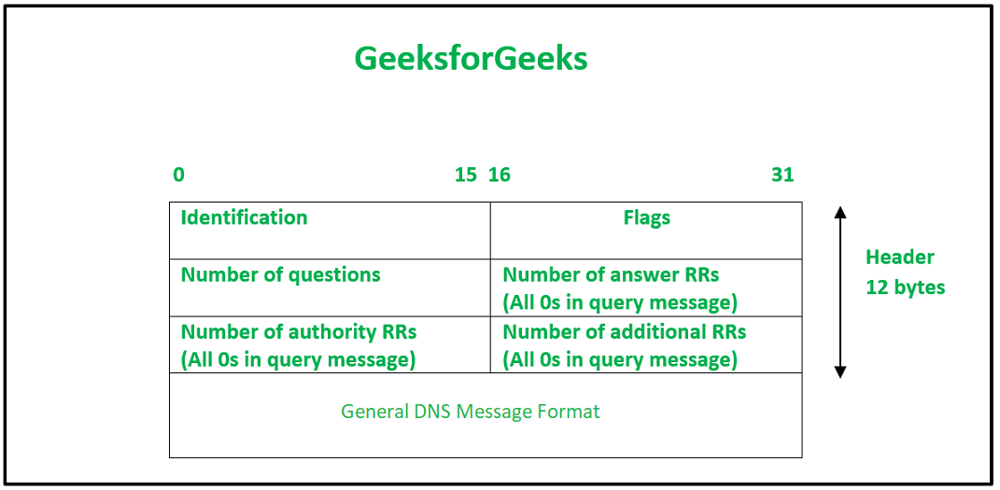
---
layout: two-cols
---

# CIA for DNS (msg format)

**https://www.geeksforgeeks.org/dns-message-format/**** **

::right::

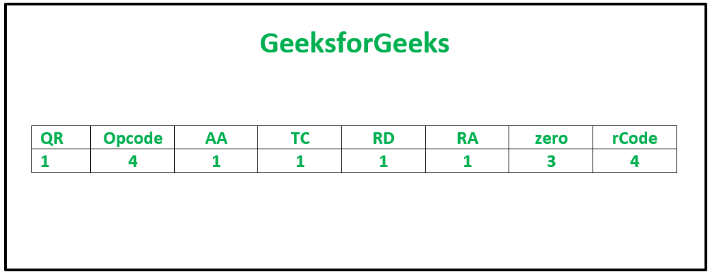
---
layout: section
class: text-center
---
# CIA for DNS (type of records)
---
layout: section
class: text-center
---
# CIA for DNS (type of records)
---
layout: section
class: text-center
---
# CIA for DNS (type of records)
---
layout: section
class: text-center
---
# CIA for DNS (how it works)
---

**https://www.geeksforgeeks.org/what-is-recursive-dns/**** **

---
layout: two-cols
---

# CIA for DNS (DNS Vulnerabilities)

**https://sansorg.egnyte.com/dl/FKIbwsOvgc**** **

::right::

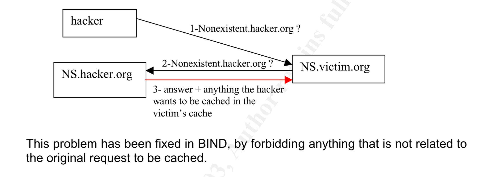
---
layout: section
class: text-center
---
# CIA for DNS
---
layout: two-cols
---

# CIA for DNS (DNSSEC)

**1**

**1**

**0**

**2**

**2**

**3**

**3**

**0’**

**https://medium.com/iocscan/how-dnssec-works-9c652257be0**** **

::right::

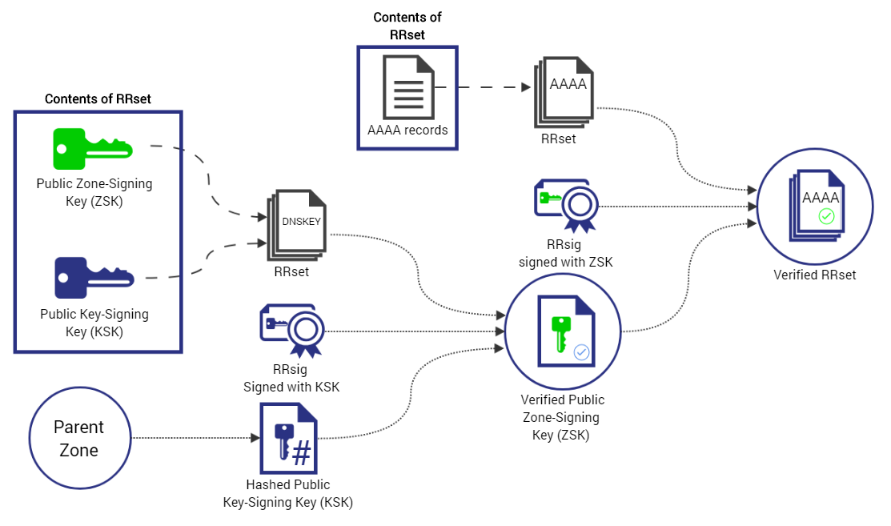
---
layout: section
class: text-center
---
# CIA for DNS (DNSSEC)
---

**0’**

**0’**

**https://medium.com/iocscan/how-dnssec-works-9c652257be0**** **

---
layout: two-cols
---

# CIA for DNS (DNSSEC)

**https://www.iana.org/dnssec/ceremonies/53-2**** **

::right::

---
layout: section
class: text-center
---
# - NSEC records:
- example.com. 300 IN NSEC  alice.example.com. A RRSIG NSEC
- alice.example.com. 300 IN NSEC edward.example.com. A RRSIG NSEC
- edward.example.com. 300 IN NSEC susan.example.com. A RRSIG NSEC
- susan.example.com. 300 IN NSEC example.com. A RRSIG NSEC
  - With NSEC if you ask for **mihai.example.com **you get **edward** and **susan**
- With NSEC3 if you ask for **mihai.example.com **you get **HASH(****edward****)** and **HASH(****susan****)**
  - FSK5....example.com. 300 IN NSEC3 **1 0 10 1234567890ABCDEF **JKMA... A RRSIG
    - 1 represents the algorithm,
    - 0 represents the opt-out flag (no signing for this info),
    - 10 represents the number of iterations,
    - and 1234567890abcedf is the salt.
---
layout: section
class: text-center
---
# CIA for DNS (DNSSEC - NSEC)
---
layout: two-cols
---

# CIA for DNS (Abusing DNS – FastFlux)

**1**

**2**

**https://unit42.paloaltonetworks.com/fast-flux-101/**** **

::right::

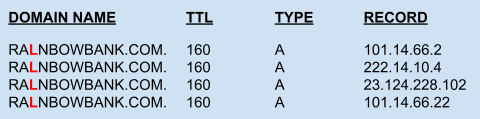

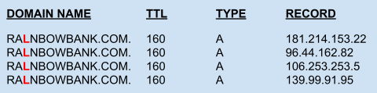
---
layout: two-cols
---

# CIA for DNS (Abusing DNS – Domain Generating Algs)

**https://www.akamai.com/glossary/what-are-dgas**** **

::right::

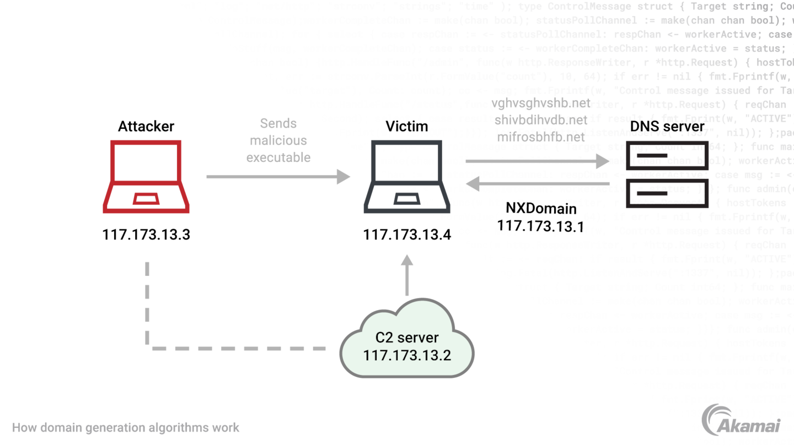
---
layout: two-cols
---

# CIA for DNS (Abusing DNS – Exfiltration/C2C)

**https://unit42.paloaltonetworks.com/dns-tunneling-how-dns-can-be-abused-by-malicious-actors/**** **

::right::

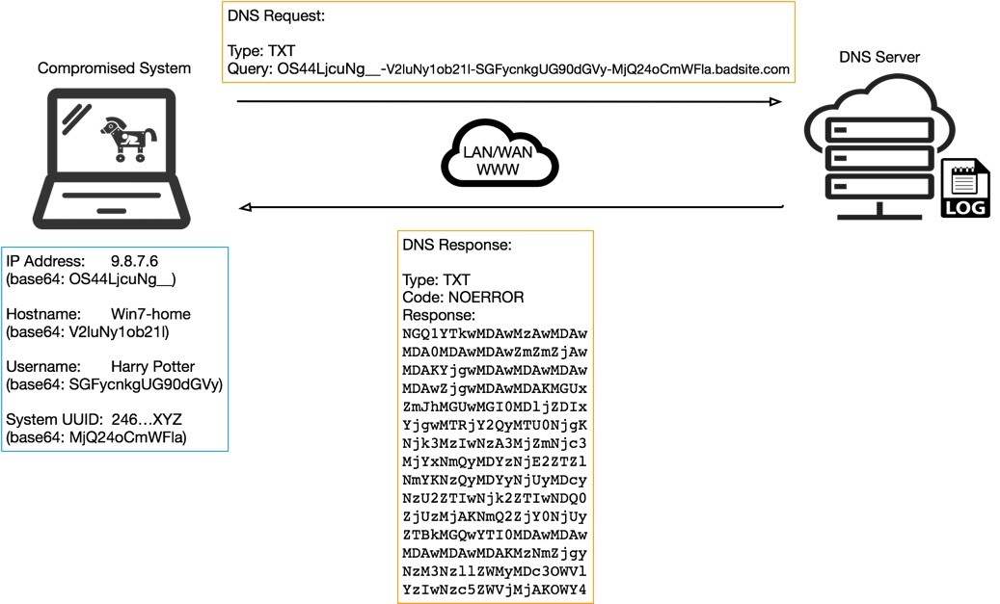
---

# CIA for DNS (Abusing DNS – Exfiltration/C2C)

**https://blogs.infoblox.com/community/dns-data-exfiltration-how-it-works/**** **

---
layout: two-cols
---

# CIA for DNS (Abusing DNS - DDOS)

**https://www.cloudflare.com/learning/ddos/dns-amplification-ddos-attack/**** **

::right::

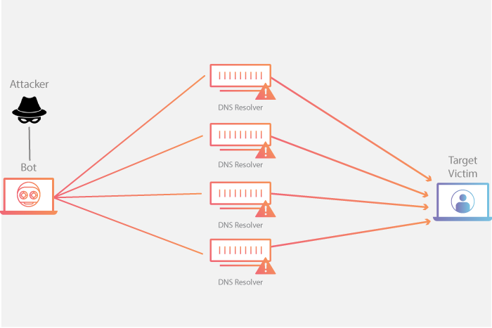
---

# CIA for DNS (IDS for DNS)

**https://sansorg.egnyte.com/dl/r4ouqZy5dp**** **

---
layout: focus
---
# - https://mxtoolbox.com/SuperTool.aspx
- Sender Policy Framework

- https://www.emailonacid.com/blog/article/email-deliverability/email-authentication-protocols/
---
layout: two-cols
---

# - https://mxtoolbox.com/SuperTool.aspx
- DomainKeys Identified Mail

- https://www.emailonacid.com/blog/article/email-deliverability/email-authentication-protocols/

::right::

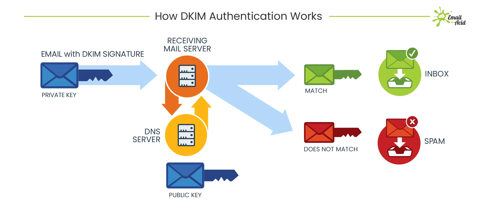
---
layout: two-cols
---

# - https://mxtoolbox.com/SuperTool.aspx
- Authenticated Received Chain (e.g. mailing list)

- https://blog.mdaemon.com/arc-authenticated-received-chain-and-what-problem-does-it-solve

::right::

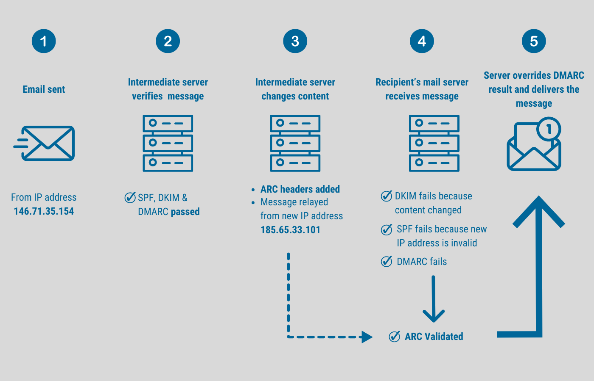
---
layout: two-cols
---

# - https://mxtoolbox.com/SuperTool.aspx
- Domain-based Message Authentication, Reporting, and Conformance

- https://www.emailonacid.com/blog/article/email-deliverability/email-authentication-protocols/

::right::

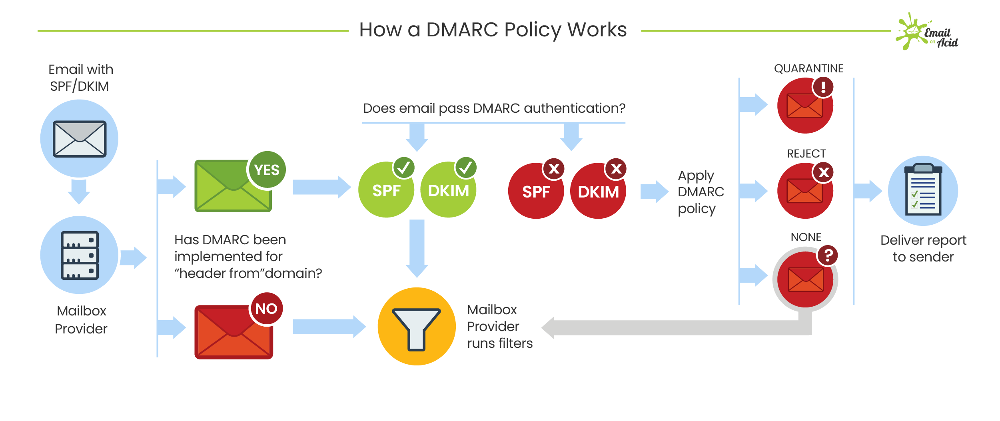
---
layout: two-cols
---

# CIA for HTTP(S)

- https://supertokens.com/blog/what-is-tls

::right::

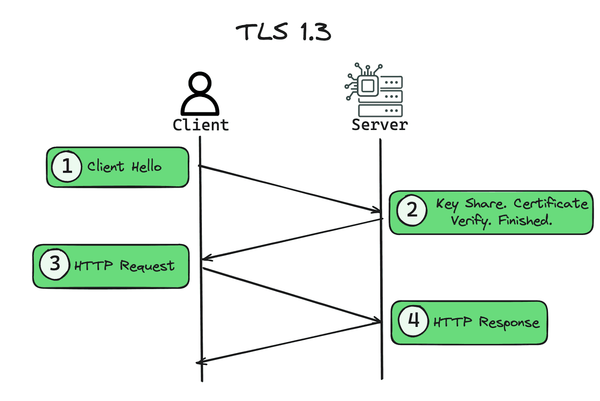

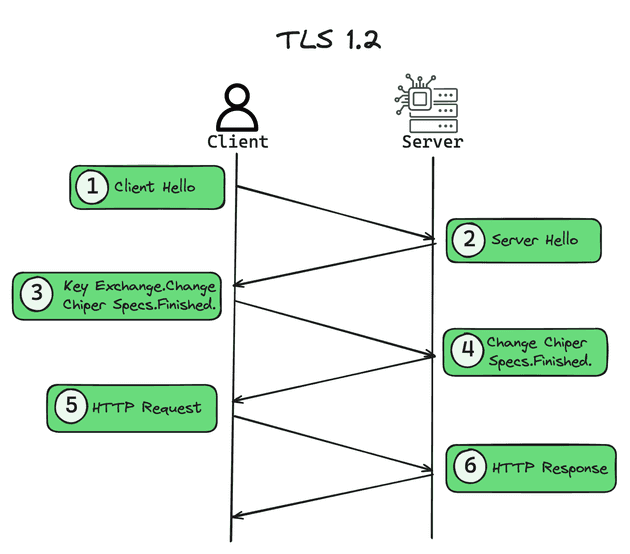

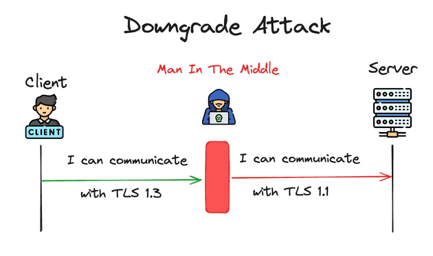
---
layout: section
class: text-center
---
# CIA for HTTP(S) - CAA
---
layout: two-cols
---

# CIA for HTTP(S)  - CT

- https://cheapsslsecurity.com/blog/what-is-certificate-transparency-ct-how-does-it-work/

::right::

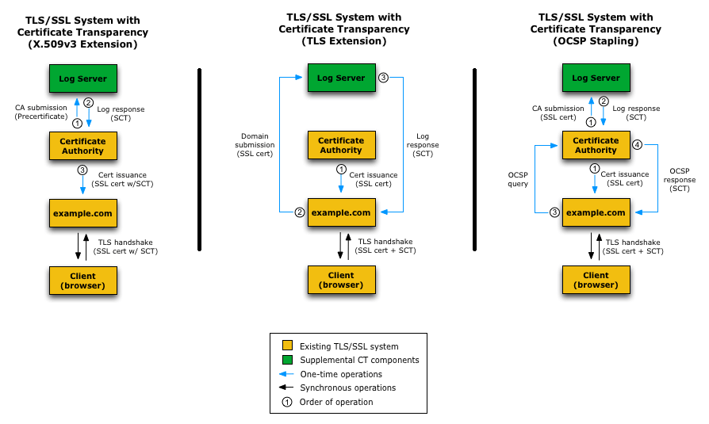
---
layout: section
class: text-center
---
# CIA for HTTP(S) - PFS
---

# CIA for HTTP(S) – CRL & OCSP

- https://cheapsslweb.com/blog/ocsp-vs-crl-which-certificate-revocation-method-is-best/

---
layout: section
class: text-center
---
# CIA for HTTP(S) - HSTS
---
layout: section
class: text-center
---
# CIA for HTTP(S) - Cookies
---
layout: section
class: text-center
---
# DoS Availability against stronger adversaries
---
layout: section
class: text-center
---
# Muscle vs intelligence
---
layout: section
class: text-center
---
# tcp_syncookies = 1
---
layout: section
class: text-center
---
# References